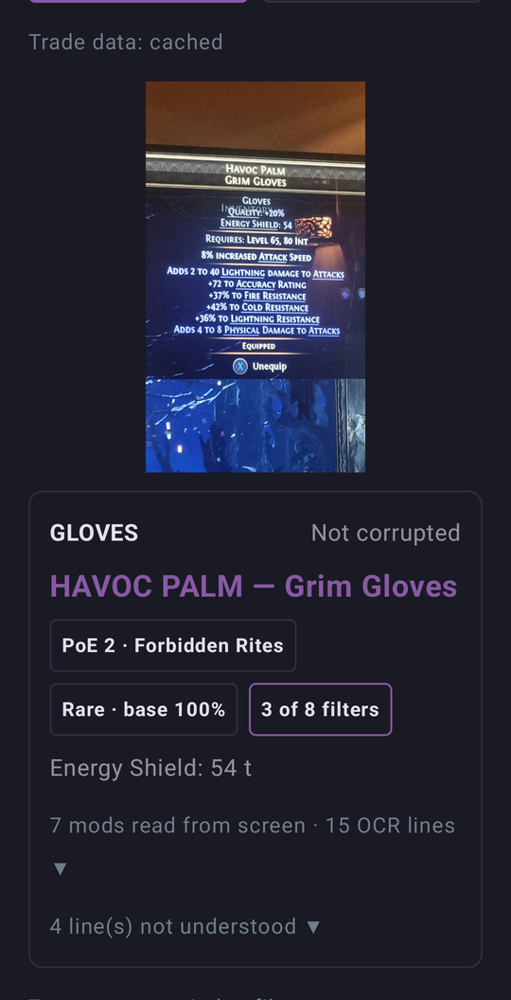
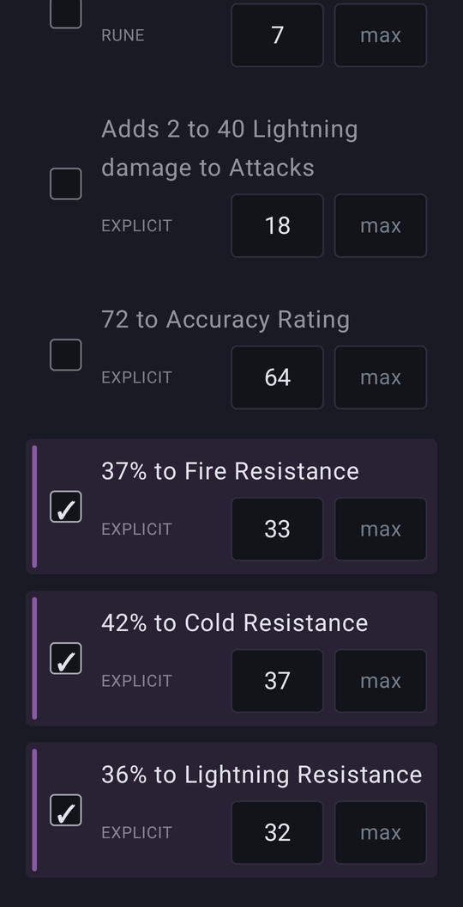
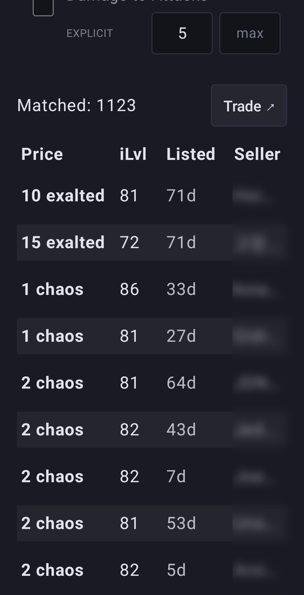

# Looting Glass for Android (proof of concept)

Price check a Path of Exile item by **photographing its tooltip on a TV**. The OCR runs on the
phone; the price search uses [Looting Glass](https://github.com/looting-glass/desktop)'s Rust core.

**Status:** proof of concept. Accuracy figures are in [RESULTS.md](RESULTS.md).

**Website:** [looting-glass.github.io/android.html](https://looting-glass.github.io/android.html)

<p align="center">
  
  
  
</p>

## Install

Download the APK from the [latest release](https://github.com/looting-glass/android/releases/latest)
on the phone, open it and allow installing from your browser when Android asks. Needs Android 8
or newer on a 64-bit phone.

Usage: pick the game, platform and league, tap **Take photo**, zoom in until the item tooltip
fills the frame and capture. The parsed item, its search filters and the cheapest listings
appear below; tap a filter to switch it on or off, and the search re-runs.

Fan-made; not affiliated with or endorsed by Grinding Gear Games. GPL-3.0-or-later.

## Layout

| Path | What |
|---|---|
| `core/` | Rust library. `item.rs`, `ninja.rs` copied from looting-glass; `trade.rs`, `config.rs` adapted (console realms, no desktop config); `data.rs` trade data; **`screen.rs` the fuzzy screen-text parser** |
| `core/data/` | Snapshot of `/data/stats`, `/data/items`, `/data/leagues` for both games (tests and eval; the app downloads fresh copies) |
| `ffi/` | UniFFI bindings (`Engine`: `load`, `parse`, `search`, `ninja`, `leagues`) |
| `android/` | Kotlin + Jetpack Compose app: ML Kit text recognition v2 (bundled model), CameraX, photo picker |
| `tools/eval/` | Accuracy harness: images (or ML Kit OCR JSON) + Ctrl+C ground truth → score |
| `tools/render_tooltips.py` | Renders stand-in tooltip images (clean + simulated TV photo) from item texts |
| `testdata/items/` | Ground-truth item texts: 21 for the rendered sets, `r*` for real PoE 2 screenshots, `x*` for phone photos of an Xbox |
| `testdata/{screens,photos,real,xbox}/` | Test images; `testdata/mlkit/` the ML Kit OCR output for each set |
| `testdata/baseline.txt` | Minimum score per set; `scripts/check-accuracy.sh` (and CI) fail below it |

## How the screen parser works

`screen::parse(lines, data)` takes OCR lines with boxes and sampled text colour and returns the
same `Item` the clipboard parser does. It rebuilds Ctrl+C-style text and runs the clipboard
parser on it, so everything downstream (`trade::prepare`, search, ninja) is reused unchanged.

1. Tooltip isolation: the header (name + base) and the lines centred under it; UI around the
   tooltip is dropped. Rows top to bottom; sections split where the line pitch jumps compared
   with nearby lines (the drawn dividers; robust to a tilted photo).
2. Header: fuzzy match against trade bases (`/data/items`); unique names are only accepted if that
   unique uses the matched base. Rarity from header colour, falling back to header shape.
3. OCR clean-up: `l/I/O/S/B/Z` inside numbers, "TO" read as "10", "+" read as "4", "%" read as "6".
4. Mods: trigram shortlist over ~18k trade stat texts, then edit distance; accepted at ≥ 0.78.
   The match *replaces* the OCR text, which corrects misreads ("Resistanoe", "Lire").
5. Implicit vs explicit from section layout; crafted/fractured from colour relative to the item's
   typical mod colour; a stat that can't be the guessed kind (rune, enchant) gets one it can be.
6. Every unmatched line is reported with its best score.

## Build

Needs Rust (with the `aarch64-linux-android` and `x86_64-linux-android` targets), `cargo-ndk`,
JDK 17–21, the Android SDK (platform 37) and NDK.

```bash
cargo test -p lootlens-core
```

```bash
cd android && ./gradlew assembleDebug
```

Gradle's `preBuild` runs `scripts/build-rust.sh`, which cross-compiles the Rust core and
regenerates the Kotlin bindings. The APK ends up in `android/app/build/outputs/apk/debug/` and
installs on Android 8+ (`adb install`, or sideload).

## Measuring accuracy

```bash
scripts/check-accuracy.sh            # every set's ML Kit OCR against testdata/baseline.txt
cargo run --release -p lootlens-eval -- testdata/items testdata/mlkit/xbox   # one set, per item
```

For each `testdata/items/<name>.txt` the harness looks for `<name>.png|jpg` (OCR'd with Tesseract
on the desktop; needs `eng.traineddata`) or `<name>.ocr.json` (OCR exported by the app with ML
Kit). `EVAL_DEBUG=<name>` prints the OCR lines and the rebuilt clipboard text.

To get ML Kit output for a set of images, push them to the app and run its batch mode:

```bash
adb shell "run-as dev.lootingglass.android mkdir -p files/testset"   # then copy images in via /data/local/tmp
adb shell am start -n dev.lootingglass.android/.MainActivity --ez batch true
adb shell run-as dev.lootingglass.android ls files/ocr               # <name>.ocr.json, done.txt (timings)
```

**Adding real test data:** save a screenshot as `testdata/real/<name>.png` and the item's Ctrl+C
text as `testdata/items/<name>.txt`, export its ML Kit OCR with batch mode into
`testdata/mlkit/real/`, and raise `testdata/baseline.txt` to the new score. Put `poe2` in the
name for PoE 2 items. Blur player names before committing (the repo is public).

## Releases

Conventional Commit PR titles drive [release-please](https://github.com/googleapis/release-please):
it keeps a release PR open that bumps `version.txt` and `CHANGELOG.md`; merging it tags the
release, and CI builds the signed APK and attaches it. `gh workflow run build.yml --ref <branch>`
builds a test APK of any branch. See [AGENTS.md](AGENTS.md).
